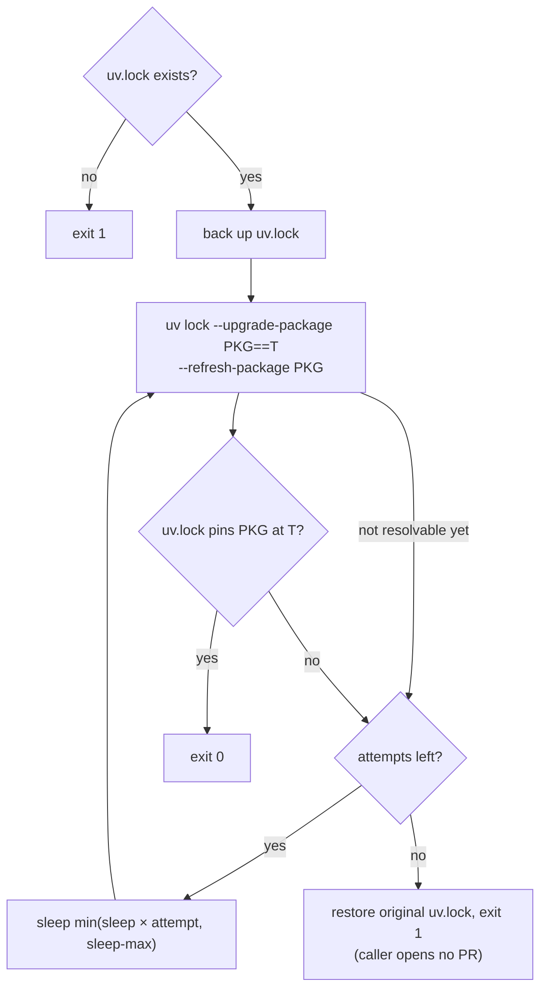

# `uv-relock`

Composite action used by [`bump-consume.yml`](../../.github/workflows/bump-consume.yml)
for the `uv` ecosystem. It locks the consumer to exactly `PKG==T` and **fails closed** if
the index never serves `T`. The logic is in [`relock.sh`](relock.sh), and
[`tests/bump-uv`](../../tests/bump-uv/run.sh) runs it offline.

## Why

The old step ran `uv lock --upgrade-package PKG` with no version, which takes whatever the
index serves at that moment. The workflow's registry wait polls PyPI's JSON API, and that
API sees a new release before the simple index that uv resolves against. So the lock landed
one release behind the PR title. acdp-playground #110 was titled 0.18.3 but locked 0.18.2;
#111 was titled 0.19.0 but locked 0.18.3.

## Flow

`pyproject.toml` is never edited. If its requirement excludes `T`, the lock fails, and so
does the job.

## Inputs

| Input | Default | Meaning |
|---|---|---|
| `package` | (required) | Package name (PEP 503-normalized for the lock lookup). |
| `version` | (required) | Target version. |
| `attempts` | `10` | Max lock attempts. |
| `sleep` | `10` | Base seconds between attempts; attempt *n* waits `sleep × n`. |
| `sleep-max` | `60` | Cap on one wait. With the defaults the worst case is about 6.5 minutes. |
